tunnel shape: © OpenStreetMap contributors, ODbL

backend / devops · сети, автоматизация, Python, Go, Rust

#### stack

  
  
  
  
  
  
  
  

#### projects

<table>
<tr>
<td width="50%" valign="top">

**[spliceRTC](https://github.com/rypleshhh/splicertc)**

TCP/TLS-туннель на Go с нуля для обхода блокировки нестандартных портов: полноценный VPN-режим и канал для игрового UDP с TTL-дропом и мультипас-дублированием, четырьмя независимыми каналами. 

`Go` `TLS` `TUN/TAP` `Docker`

</td>
<td width="50%" valign="top">

**[moth-amp](https://github.com/rypleshhh/moth-amp)**

Неофициальный клиент Яндекс Музыки для Windows и Android без аналитики и трекеров. Ядро и бэк на Rust, интерфейс на Flutter, параметрический эквалайзер с импортом AutoEq, кэш в mp3/flac, импорт своей музыки из S3 на NAS.

`Rust` `Flutter` `S3` `Docker`

</td>
</tr>
<tr>
<td width="50%" valign="top">

**[GreenCity]** · ЛЦТ 2026, команда «Вороны»

Автопроектирование озеленения по DXF-чертежам с учётом подземных коммуникаций и нормативов, правка плана текстом через LLM. Занимался DevOps и сетевой частью, оптимизация производительности (в том числе 3D-сцены, генерации).

`Docker` `DevOps` `Python` `FastAPI`

</td>
<td width="50%" valign="top">

**[main_argbot](https://github.com/Rypleshhh/main_argbot)**

Telegram-бот мониторинга АЗС с платным доступом и Mini App. Один скрапер обслуживает несколько ботов, HTTPS через DuckDNS на кастомном порту. Развитие [sberazs_bot](https://github.com/Rypleshhh/sberazs_bot).

`Python` `FastAPI` `Caddy` `Docker`

</td>
</tr>
</table>

также: [dorm-vpn-bypass](https://github.com/Rypleshhh/dorm-vpn-bypass) — обход DPI-блокировки UDP через VLESS+Reality на OpenWrt-роутере

#### contacts

telegram: [@ryplesh](https://t.me/ryplesh)
email: ryplesh@tuta.io
